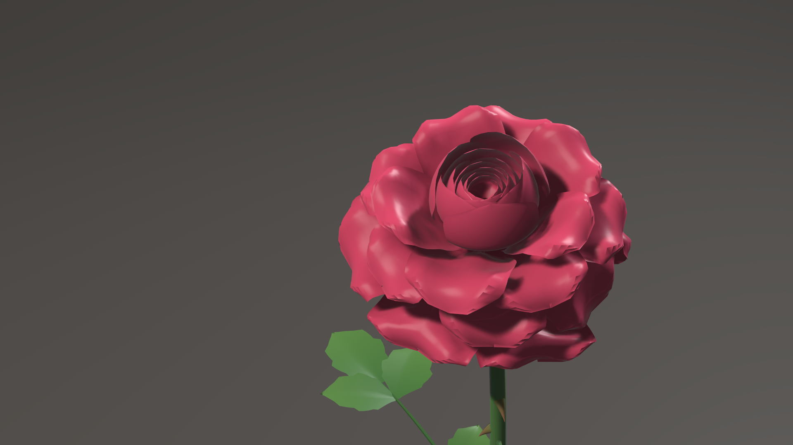

# Flower Generator for Houdini

One SOP node that grows a complete flower (petals, center, stem) from a species
preset, with a bloom you can scrub or time. Everything is native Houdini nodes
and VEX: no plugins, no simulation, no caching, and any renderer works.

Version 0.1.0, built for Houdini 22. Rose, tulip and daisy presets build the
whole plant: petals, sepals, receptacle or disc florets, stamens, pistil, stem,
simple or compound leaves, and thorns. The bloom keeps petals from passing
through each other in two ways: the closed bud is built as nested shells, and a
de-intersect pass opens any overlapping petal a little further on its hinge,
then pushes out what is left.

<!-- Demo: docs/media/rose_demo_poster.png and docs/media/rose_demo.mp4 ship in the repo, not in the release zip; absolute links so the zip's README works too -->
[](https://github.com/KyleSullivan321/FlowerGenerator-Houdini/blob/main/docs/media/rose_demo.mp4)

`hython tests/intersection_test.py` measures real crossings with Houdini's
Intersection Analysis across the bloom, with the pass off and on.

## Requirements

- Houdini 22.0 (built and tested with Houdini Indie 22.0.368).
- SideFX gives each licence its own file format: `.hda` for Houdini FX and Core, `.hdalc` for
  Indie, `.hdanc` for Apprentice and Education ([SideFX licensing](https://www.sidefx.com/Support/licensing/)).
  The ready-made node in `otls/` is an Indie asset (`.hdalc`):
  - **Houdini Indie:** use it as it is.
  - **Houdini FX or Core:** build the node under your own licence from the source included in the release zip and in the
    [GitHub repo](https://github.com/KyleSullivan321/FlowerGenerator-Houdini) with
    `hython python/build_hda.py` (it writes `otls/ksd_flower_generator.hda`), and remove the `.hdalc`
    from your Houdini path. Keep the Indie file out of a commercial pipeline: SideFX keeps the formats
    apart, and its commercial Houdini Engine licences refuse `.hdalc` assets
    ([SideFX FAQ](https://www.sidefx.com/faq/question/why-cant-i-use-assets-created-in-houdini-indie-with-houdini-engine-for-unityunreal-licenses/)).
  - **Apprentice and Education:** not tested. The build script writes `.hdanc` there.

## Install

1. Download a release zip (or clone [the repo](https://github.com/KyleSullivan321/FlowerGenerator-Houdini)) and unpack it to a permanent folder.
2. Copy `houdini_flower_generator.json` into `Documents/houdini22.0/packages/`
   and edit `FLOWERGEN` in it to the folder you unpacked into.
3. Start Houdini, drop a Geometry node, dive in, press Tab and look under **Flower**.

## Use

Pick a **Species**, press **Randomize** for a variation, and set the bloom on the
**Animation** tab: **Bloom Slider** to set or keyframe it yourself, or **Timed
Bloom** with a start frame and duration. Every other tab is optional depth.

For smooth scrubbing, open **Cache** on the Animation tab: **Save to Disk** cooks and writes every
frame of the bloom to Cache File (Esc cancels), and **Load from Disk** reads those files instead of cooking.
Save again after changing any other parameter.

## Build from source

The node is built from the VEX in `vex/` and the Python in `python/` by a
headless script, so every change is a readable diff:

```
hython python/build_hda.py      # writes otls/ksd_flower_generator.hda(lc)
hython tests/smoke_cook.py      # cooks every species at bloom 0, 0.5 and 1
hython tests/intersection_test.py 10   # crossings across the bloom, pass off and on
hython tools/render_preview.py renders/check   # Karma CPU previews
hython tools/render_bloom.py renders/bloom rose   # bloom animation frames
hython tools/debug_crossings.py out.png rose 0.5  # crossings painted red
python tools/presets_edit.py rose petal_count=48  # edit a preset value
```

The build writes `.hdalc` on an Indie licence, `.hdanc` on Apprentice or Education and `.hda` on a commercial one, so
anyone can rebuild the node under their own licence. The HDA type name is `ksd::flower_generator::1.0`.

## Layout

| Path | What it holds |
| --- | --- |
| `vex/` | One file per wrangle inside the node; `vex/lib/` holds shared code inlined at build time |
| `python/build_hda.py` | Builds the network, the parameter interface and the HDA |
| `python/flowergen/` | Parameter interface and the node's Python module (species presets) |
| `presets/species.json` | Species presets |
| `tests/` | Headless checks |
| `tools/` | Preview renders |
| `otls/` | The built node |

## Licence

Flower Generator for Houdini is source-available under the [PolyForm Small Business License 1.0.0](LICENSE). It is free
for any use, commercial included, by individuals and by companies with fewer than 100 people and less than
1,000,000 USD (2019, adjusted for inflation) in revenue in the prior tax year. Larger companies need a
commercial licence: contact Kyle Sullivan at [kylesullivandesign.com](https://kylesullivandesign.com).

## Credits

FLOPs (Floral Operators), a GPL-3.0 KineFX flower toolkit for Houdini, was a reference for ideas
while this node was designed. No FLOPs code is included.
